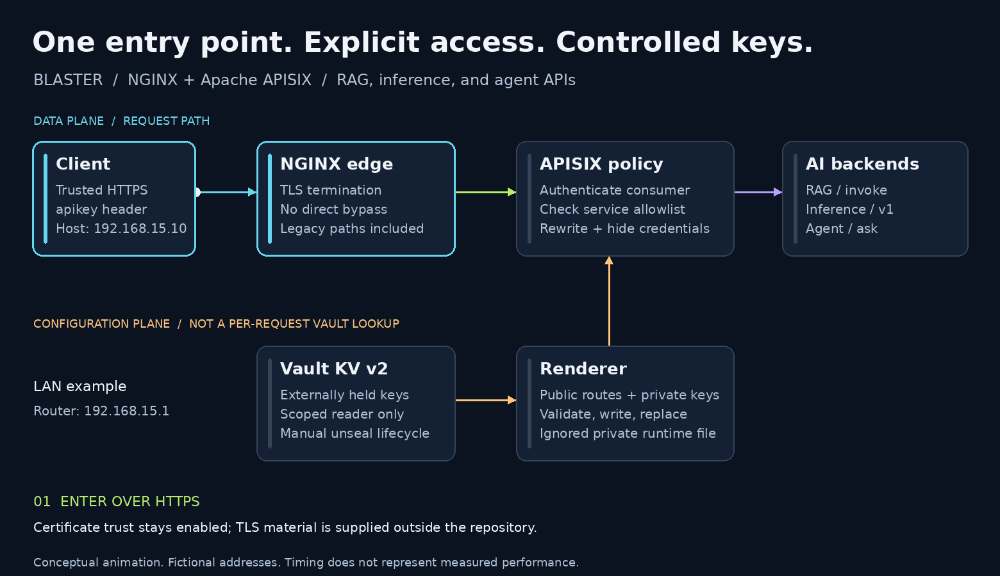
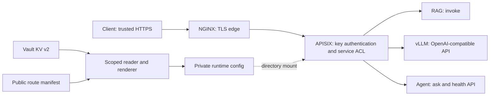

# Blaster — one gateway for an AI platform

**A single HTTPS entry point for retrieval, model inference, and agent APIs, with explicit authentication and a controlled key lifecycle.**

[Architecture](docs/architecture.md) · [Blaster administration guide](docs/administration.md) · [Security review](docs/security-review.md) · [Validation](docs/validation.md) · [Version history](CHANGELOG.md) · [MIT license](LICENSE)

An AI platform grows beyond a single model endpoint. Retrieval, inference, agents, and observability each bring their own paths, ports, credentials, and operational habits. Blaster brings the API boundary into one place: NGINX handles HTTPS, Apache APISIX authenticates and routes requests, and Vault stores consumer keys for controlled configuration updates.

This repository consolidates **BLASTER-MCP-GW** and **Blaster2.0** into one reviewable project. It combines the first repository's gateway implementation with the second's later agent integration and operational context, then removes machine-specific secrets and closes the legacy authentication bypasses. The original repositories remain unchanged.

**Release: v1.1.1 — consolidated portfolio source, with reviewed gateway policy and documented deployment boundaries.**

## What the project demonstrates

| Engineering problem | Blaster's approach | Resulting capability |
| --- | --- | --- |
| Several AI services expose unrelated ports | One NGINX → APISIX API entry point | Stable public paths with explicit upstream rewrites |
| Legacy and new routes coexist | All supported aliases traverse authentication | Migration paths without unauthenticated backend shortcuts |
| A valid key grants too much access | Explicit consumer allowlists per service | The demo user cannot access the agent API |
| Secrets drift into configuration and scripts | External credential files or a scoped Vault reader | No checked-in consumer keys or root-token automation |
| Runtime configuration contains usable keys | Private, ignored output, atomically replaced | Clear separation between public routing policy and sensitive runtime state |
| Two repositories tell different parts of the story | One architecture, runbook, history, and review record | A coherent portfolio project with traceable limits |

## Follow a request

[](docs/assets/blaster-workflow.png)

*Conceptual animation, not measured timing. [Static alternative](docs/assets/blaster-workflow.png). Vault participates in configuration updates, not every inference request.*

1. The client connects over HTTPS with its `apikey` header.
2. NGINX terminates TLS and forwards the request to the internal APISIX service.
3. APISIX authenticates the key and checks the consumer's service allowlist.
4. A rewrite translates the public path into the backend's native API path.
5. The response returns through the gateway; client credentials are hidden from the backend.

The source used `/mcp/` in several paths. These are historical HTTP route names: this repository does **not** implement MCP JSON-RPC, tool discovery, or MCP transport semantics.

## Architecture at a glance



Backends are external prerequisites; their model, retrieval, and agent code are not bundled. Langfuse remains part of the documented platform context, but this reviewed configuration does not publish its GUI at `/`. A browser UI needs its own authenticated access design; the root currently has no application route.

## Public routes and permissions

| Preferred route | Upstream behavior | Demo access |
| --- | --- | --- |
| `POST /api/rag` | RAG `/invoke` | `demo-user`, `agent-service` |
| `/api/inference/*` | Strip `/api/inference/` | `demo-user`, `agent-service` |
| `/api/agent/*` | Strip `/api/agent/` | `agent-service` only |
| `/healthz` | Edge process liveness only | No key required |

The historical `/elita-energon`, `/elita-energon/mcp/v1`, `/elita-inference/`, `/elita-inference/mcp/`, and `/elita-acra/api/` paths remain authenticated aliases. A missing or invalid key should receive `401`; an authenticated consumer outside a service's allowlist should receive `403`. Those targets must be confirmed against the running gateway before deployment.

Routing and consumer names live in [config/routes.yml](config/routes.yml). API-key values do not.

## A portable sample network

All LAN examples use the requested fictional topology:

| Item | Example |
| --- | --- |
| Blaster host | `192.168.15.10` |
| LAN gateway/router | `192.168.15.1` |
| LAN subnet | `192.168.15.0/24` |
| Example HTTPS URL | `https://192.168.15.10:8443` |

These are documentation values, not an address assignment. Compose publishes the edge on **loopback by default**; change the bind address only for your own environment. Backend containers are reached through `host.docker.internal` and explicit ports. APISIX has no published data-plane or Admin API port. The optional Vault administration port is loopback-only.

## Prepare a local review deployment

You need Python 3.12+, Docker Compose with host-gateway support, external backend services, and operator-managed TLS files outside this repository. No certificate, private key, Vault initialization file, or real credential is included.

```bash
python3 -m venv .venv
.venv/bin/python -m pip install -r requirements.txt
cp .env.example .env
# Edit .env: point BLASTER_TLS_DIR to an existing private directory outside this repo.
# Store real consumer credentials outside this repo, with mode 600.
.venv/bin/python tools/render_config.py --secrets-file "$HOME/.config/blaster/consumers.json"
docker compose config --quiet
docker compose up -d edge apisix
```

The renderer rejects missing, duplicate, short, and placeholder keys. Rendering writes `runtime/apisix/apisix.yaml` with mode `600` under a mode-`700` directory. That file contains usable plaintext credentials and is ignored by Git. A failed render leaves the last successfully rendered configuration in place.

The **[Blaster administration guide](docs/administration.md)** explains credential preparation, the Vault alternative, key rotation and revocation, service changes, and rollback. Use a trusted CA bundle in clients; the maintained examples do not disable certificate verification.

## Blaster administration guide

The [Blaster administration guide](docs/administration.md) is the operational reference for this consolidated project. It covers private credential preparation, startup and health checks, scoped Vault access, consumer permissions, rotation/revocation, service changes, rollback, and troubleshooting.

Start with [adding a consumer](docs/administration.md#6-add-a-consumer), [rotating or revoking a key](docs/administration.md#7-rotate-or-revoke-a-key), or [rollback and recovery](docs/administration.md#9-reload-rollback-and-recover). Each operation includes the verification needed to distinguish a changed file from an applied gateway policy.

## Security changes worth inspecting

| Source behavior | Consolidated behavior |
| --- | --- |
| Credential defaults in clients and examples | No operational credential defaults; display placeholders use `XXXXXX` |
| Old paths bypassed APISIX or had weak shared-token checks | All supported service aliases require APISIX authentication |
| Every consumer could call every protected route | Per-service allowlists |
| Root/unseal credentials loaded automatically from initialization files | Manual Vault lifecycle; renderer rejects the root policy |
| TLS verification disabled in clients | Verification remains enabled; TLS material is external |
| Live generated config and operational notes mixed with source | Private runtime directory and clean Git history |
| Vault/backend ports could bypass the gateway boundary | No APISIX host port; Vault loopback-only; backend firewall remains an operator responsibility |

Read the **[security review](docs/security-review.md)** for the actual findings, scan scope, remaining risks, and credential-rotation follow-up for the original repositories. Sanitizing this new repository does not revoke credentials exposed elsewhere.

## Evidence and validation

The sources describe successful authenticated requests, rejection of missing/invalid keys, and later agent/trace integration. They are historical operator reports, not new benchmark measurements. Their credential-bearing transcripts and certificate metadata have not been copied.

This consolidation adds renderer/ACL tests, negative credential tests, local link validation, Compose checks, and full-history secret scanning. The [validation record](docs/validation.md) distinguishes automated checks from live integration tests and documents exactly what still needs review. No throughput, latency improvement, or production-readiness claim is made.

## Versions and repository map

**`v1.0.0`** is the clean consolidation baseline. **`v1.1.0`** preserves the expanded review candidate; **`v1.1.1`** prepares that reviewed implementation for publication on `main`. Annotated `source/v2.0.1`, `source/v2.1.0`, and `source/v2.2.0` tags preserve sanitized source-milestone notes on archive branches, without importing sensitive source Git objects. See [provenance](docs/provenance.md).

| Directory | Purpose |
| --- | --- |
| [gateway/](gateway) | NGINX edge and standalone APISIX process configuration |
| [config/](config) | Public route manifest and service consumer allowlists |
| [vault/](vault) | Local administration server config and read-only reader policy |
| [tools/](tools) | Credential generation, rendering, scans, and documentation checks |
| [tests/](tests) | Security-relevant configuration and scanner tests |
| [docs/](docs) | Architecture, administration, security, validation, and source history |

Original project code and documentation use the [MIT license](LICENSE); dependencies retain their own terms. See [CONTRIBUTING.md](CONTRIBUTING.md) and [SECURITY.md](SECURITY.md) for contribution and reporting guidance.
