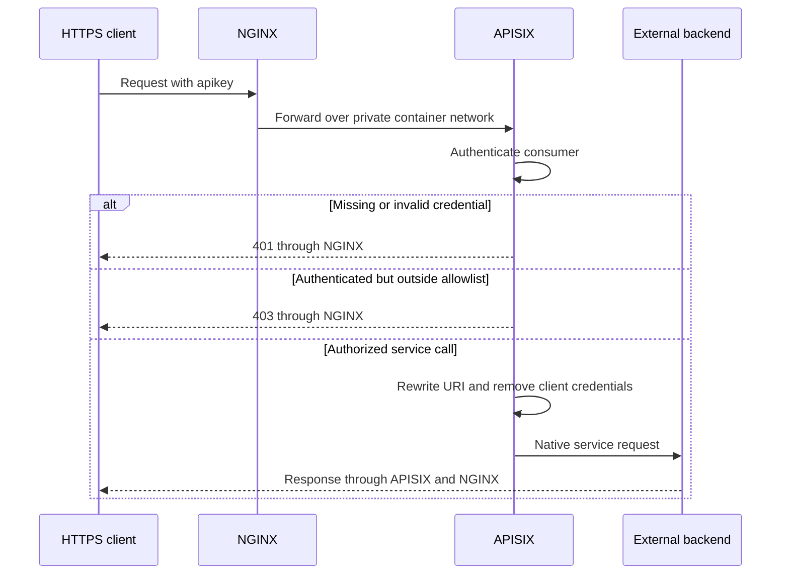
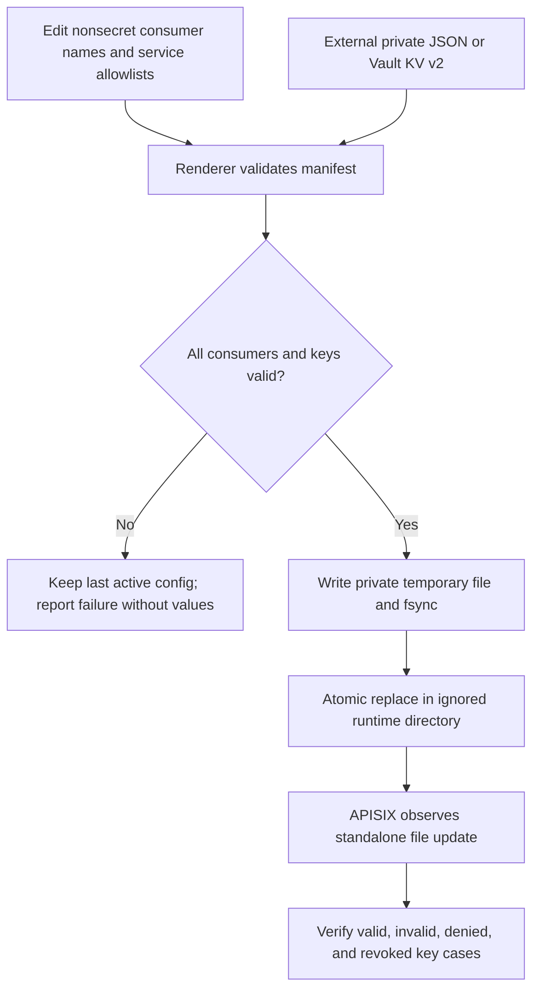

# Architecture and consolidation decisions

[Project overview](../README.md) · [Administration](administration.md) · [Security review](security-review.md)

Blaster separates the HTTPS edge, route/authentication policy, and key lifecycle. The merge is an integration of source responsibilities, not a concatenation of two repositories.

## What each source contributes

| Source | Retained concept | Consolidation decision |
| --- | --- | --- |
| BLASTER-MCP-GW | NGINX front end and APISIX standalone routes | One root Compose file and explicit named networking |
| BLASTER-MCP-GW | Vault KV v2 key storage and config rendering | Scoped-reader API client; no automated root/unseal reads |
| Blaster2.0 | Agent API integration and longer request timeout | Agent route and explicit service-account allowlist |
| Blaster2.0 | Langfuse and evaluation context | Documented external dependency; no unauthenticated UI root route |
| Both | Legacy paths and staged migration | Authenticated aliases with explicit rewrite priority |

The later narrative describes changes not present in the first source's code snapshot. The new route manifest implements the agent mapping explicitly rather than claiming an absent backend implementation was imported.

## Data plane

The edge's `/healthz` only confirms the NGINX process responds. It does not prove that a backend is healthy, a key is valid, or APISIX loaded the most recent config.

## Configuration plane

APISIX standalone configuration contains plaintext key values after rendering. Vault encrypts stored secrets at rest, but rendering does not eliminate that runtime exposure. Restrict access to the host, Docker daemon, runtime file, memory, and backups.

A directory mount lets an atomic file replacement become visible inside the container. The container links its standard standalone file location to the mounted runtime file. Hot reload must be verified for the selected image and deployment before relying on it for revocation.

## Route transformations

| Public request | Backend request |
| --- | --- |
| `POST /api/rag` | `POST /invoke` on port 15002 |
| `GET /api/inference/v1/models` | `GET /v1/models` on port 18030 |
| `POST /api/inference/v1/chat/completions` | `POST /v1/chat/completions` on port 18030 |
| `POST /api/agent/v1/ask` | `POST /v1/ask` on port 18040 |
| `GET /api/agent/health` | `GET /health` on port 18040 |

The agent path/body contract comes from the later source documentation. Its implementation, required external stores, tracing keys, and evaluation scheduler are not included or exercised by this repository.

## Network and trust boundaries

Only NGINX publishes a normal service port. The optional local Vault administration profile binds its host port to loopback, with its own network. APISIX reaches external backends through the host-gateway alias.

This is a single-host lab profile. NGINX→APISIX and APISIX→backend traffic are HTTP inside the host boundary; remote backends require a separate TLS/authentication design. Protect the external backends' own listening ports, since this repository cannot change their bind addresses or firewall rules.

Sample LAN host `192.168.15.10`, router `192.168.15.1`, and subnet `192.168.15.0/24` are fictional. Loopback and wildcard listener values are protocol-local configuration values, not leaked deployment addresses.

## Upstream references

- [APISIX deployment modes](https://apisix.apache.org/docs/apisix/deployment-modes/)
- [APISIX key authentication](https://apisix.apache.org/docs/apisix/plugins/key-auth/)
- [APISIX consumer restrictions](https://apisix.apache.org/docs/apisix/plugins/consumer-restriction/)
- [Vault KV v2](https://developer.hashicorp.com/vault/docs/secrets/kv/kv-v2)
